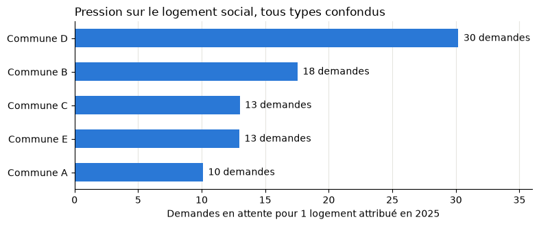
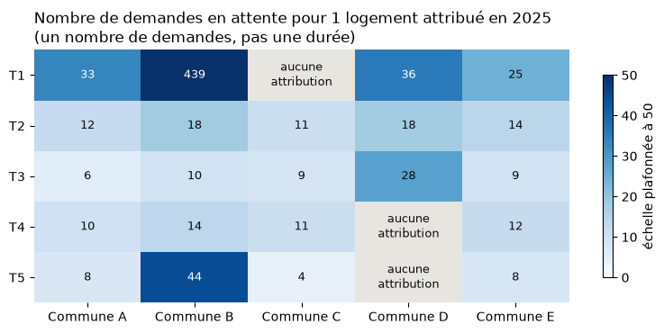

# Logement social : où la demande est-elle la plus forte ?

## Contexte

Je cherche un logement social dans mon secteur, en Île-de-France. Pour savoir où ma demande a le plus de chances d'aboutir, j'ai relevé sur le site public « Ma demande de logement social » les chiffres de cinq communes voisines. Pour chaque type de logement (T1 à T6), le site donne :

- le nombre de logements sociaux existants au 1er janvier 2025 ;
- le nombre de demandes en attente au 31 décembre 2025 ;
- le nombre de logements attribués en 2025.

Les communes sont anonymisées (Commune A à E) : seul le raisonnement compte ici.

**Question** : dans quelles communes et pour quels types de logement la demande est-elle la plus difficile à satisfaire ?

## Données

Fichier : [`logement_social_5_communes.csv`](logement_social_5_communes.csv), 28 lignes (une par commune et par type de logement), 5 colonnes.

J'ai enregistré les pages du site en PDF, puis les chiffres ont été reportés dans ce tableau. Un des PDF était en double : il n'a été compté qu'une fois.

## Indicateur choisi

**Pression = demandes en attente ÷ logements attribués dans l'année.**

Une pression de 10 veut dire qu'il y a 10 demandes en attente pour chaque logement attribué en un an. Ce n'est ni un nombre de mois ni un nombre d'années, mais un nombre de demandes. Plus le chiffre est haut, plus l'attente risque d'être longue.

Pour se faire une idée de la durée : les attributions étant comptées sur un an, une pression de 10 signifie qu'il faudrait environ 10 ans pour satisfaire toutes les demandes actuelles, si plus personne ne s'inscrivait et si le rythme des attributions restait le même. C'est un ordre de grandeur, pas un délai réel.

## Résultats

Tous types confondus, la Commune D est la plus tendue : 30 demandes pour 1 attribution, trois fois plus que la Commune A (10). La Commune A a le plus grand parc (plus de 3 000 logements), ce qui lui permet d'attribuer davantage chaque année.

- **Les T1 sont de loin les plus difficiles à obtenir** : 50 demandes pour 1 attribution sur les cinq communes. Dans la Commune B, il y a eu 1 seule attribution de T1 en 2025 pour 439 demandes.
- **Les T3 sont les plus accessibles** : 8 demandes pour 1 attribution en moyenne, et moins de 10 dans quatre communes sur cinq.
- Certains croisements n'ont eu **aucune attribution** en 2025 (T1 dans la Commune C, T4 et T5 dans la Commune D) : impossible de calculer une pression, mais c'est un signal d'alerte.

## Ce que j'en retiens

Pour maximiser mes chances, il vaut mieux élargir ma demande aux communes les moins tendues et, si ma situation le permet, viser un type de logement moins demandé que le T1.

## Limites

- Une même personne peut demander plusieurs communes : les demandes ne s'additionnent donc pas d'une commune à l'autre.
- Le rapport demandes / attributions est un indicateur, pas un délai d'attente réel : les priorités (handicap, urgence, ancienneté) changent l'ordre de passage.
- Une seule année d'attributions (2025) : une année exceptionnelle peut fausser le calcul, surtout pour les petites communes.

## Outils

Python (pandas, matplotlib). Le code est dans [`analyse.py`](analyse.py).
